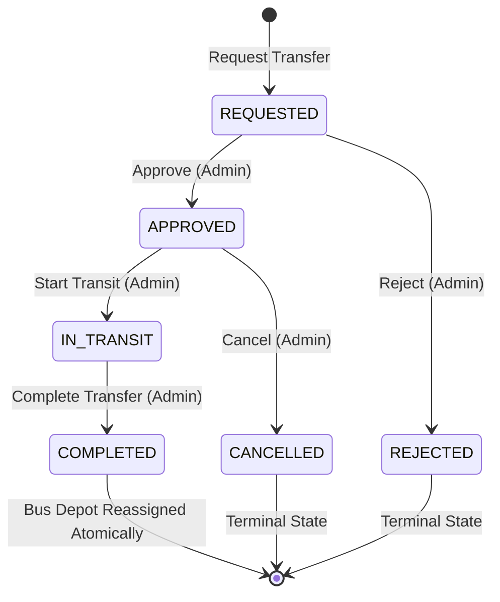

# PERUNDHU (பேருந்து) — Phase 2: Depot, Backup Depot, Workshop and Bus Stand Management

**System Documentation & Verification Report**  
*Tamil Nadu State Public Transportation Fleet Infrastructure & Operations Platform*  
**Date:** March 2026 | **Version:** 2.0.0 | **Branch:** `master`

---

## 1. Executive Summary

Phase 2 builds upon the foundational database schemas established in Phase 1 to deliver an enterprise-grade, high-reliability fleet operations platform for the Tamil Nadu State Transport Corporation (TNSTC) pilot in Madurai.

Phase 2 operationalizes:
1. **Primary, Secondary, and Backup Depot Management:** Full hierarchical registry, operational status lifecycle, capacity metrics, and multi-tenancy organization validation.
2. **Primary & Backup Depot Linkages:** Enforces strict parent-child depot topology, rejects self-referencing and circular links, verifies organization compatibility, and surfaces linked backup depots with staging reserve fleet counts.
3. **Reserve Fleet Dispatch Engine:** Clear distinction between designated reserve fleet status (`isReserveFleet = true` or `status = 'RESERVED'`) and actual dispatch eligibility (`isAvailableForDispatch`), automatically blocking dispatch if a bus has active trip assignments or is undergoing workshop maintenance.
4. **Maintenance Workshops:** Full management of depot pit lanes and regional central workshops, tracking bay occupancy percentages and specialized repair capabilities (`ENGINE_OVERHAUL`, `TRANSMISSION`, `ELECTRICAL`, `HVAC_AC`, `TYRE_RETREADING`, `BODY_REPAIR`, `ROUTINE_SERVICE`).
5. **Bus Stand & Terminal Management:** Geospatial `2dsphere` indexed bus stand registry, platform allocations, route/direction linkages, nearby proximity queries, and administrative CRUD.
6. **Depot Transfers Finite State Machine (FSM):** Multi-stage transfer lifecycle (`REQUESTED` -> `APPROVED` -> `IN_TRANSIT` -> `COMPLETED`, with `REJECTED` and `CANCELLED`), enforcing strict operational prerequisites and atomic fleet depot reassignment upon completion.
7. **Real-Time Operational DB Aggregations:** High-performance database aggregation pipelines computing global and depot-level KPIs across fleet availability, depot status, workshop bay occupancy, and active transit operations.
8. **Frontend Management Dashboard:** Pristine White Canvas, Shining Onyx Black Typography, and Electric Cyber Yellow aesthetic (`tokens.css`), providing full operational transparency and administrative workflows for depot managers.

---

## 2. Implemented Backend Architecture

### 2.1 File & Module Directory Structure

```
server/
├── src/
│   ├── models/
│   │   ├── Depot.ts                     # Depot schema with PRIMARY, SECONDARY, BACKUP types
│   │   ├── DepotTransfer.ts             # Inter-depot transfer audit and state machine
│   │   ├── MaintenanceWorkshop.ts       # Pit lanes and central workshops with bay counts
│   │   ├── BusStand.ts                  # Geospatial terminal model with platform counts
│   │   ├── Bus.ts                       # Bus fleet model with depot and reserve fields
│   │   ├── MaintenanceRecord.ts         # Maintenance job cards and workshop references
│   │   └── index.ts                     # Barrel exports
│   └── modules/
│       ├── busStands/
│       │   ├── busStand.controller.ts   # Stand CRUD & nearby endpoints
│       │   ├── busStand.routes.ts       # Public /bus-stands and admin routes
│       │   ├── busStand.service.ts      # Stand queries and geospatial searches
│       │   └── busStand.validation.ts   # Zod validation schemas
│       └── transport/
│           ├── transport.controller.ts  # 17+ depot, backup, workshop, transfer handlers
│           ├── transport.routes.ts      # Mounted at /api/v1 (depots, workshops, transfers)
│           ├── transport.service.ts     # Core business logic and FSM transitions
│           └── transport.validation.ts  # Zod validation schemas
└── tests/
    ├── unit/
    │   └── depotManagement.test.ts      # 5 unit tests for transfers, backup relationships
    └── integration/
        └── depotManagementRoutes.test.ts # 13 integration route tests with RBAC
```

---

## 3. Depot Management System

### 3.1 Depot Model Schema
Depots serve as operational home bases for fleets, crews, and route schedules:
- **`code`:** Unique depot identifier (e.g. `MDU-DEP-01`, `MDU-DEP-02`).
- **`depotType`:** Enum (`PRIMARY`, `SECONDARY`, `BACKUP`).
- **`primaryDepotId`:** Explicit reference required when `depotType === 'BACKUP'`.
- **`location`:** GeoJSON `Point` (`[longitude, latitude]`) with `2dsphere` spatial indexing.
- **`totalCapacity`:** Maximum bus staging capacity (e.g., 60 buses).
- **`serviceBaysCount`:** Inspection and light maintenance pit count.
- **`fuelPumpsAvailable`:** On-site diesel fueling capability flag.
- **`associatedBusStandIds`:** Direct operational associations with nearby bus terminals.
- **`status`:** Enum (`ACTIVE`, `INACTIVE`, `UNDER_MAINTENANCE`).

### 3.2 Depot Endpoints
| HTTP Method | Route | Access | Description |
|:---|:---|:---|:---|
| `GET` | `/api/v1/depots` | Public | Paginated list of depots with search and filters |
| `GET` | `/api/v1/depots/:depotId` | Public | Detailed depot document by ID |
| `GET` | `/api/v1/depots/:depotId/stats` | Public | Live operational statistics for a single depot |
| `GET` | `/api/v1/depots/:depotId/buses` | Public | Paginated list of fleet buses assigned to depot |
| `POST` | `/api/v1/admin/depots` | `ADMIN` | Register new depot with GeoJSON coordinates |
| `PATCH` | `/api/v1/admin/depots/:id/status` | `ADMIN` | Update operational status (`ACTIVE`/`INACTIVE`) |

---

## 4. Primary & Backup Depot Relationships

### 4.1 Topology & Validation Rules
Public transportation networks require high resilience against sudden disruptions. Backup depots stage reserve buses that can be swiftly mobilized to cover trips belonging to their primary depot.

The engine strictly validates:
1. **Self-Reference Prevention:** A depot cannot be linked to itself as its primary depot (`depotId === primaryDepotId` returns `400 Bad Request`).
2. **Type Enforcement:** Only depots with `depotType === 'BACKUP'` can specify or be reassigned a `primaryDepotId`. Attempting to set a primary depot on a `PRIMARY` or `SECONDARY` depot returns `400 Bad Request`.
3. **Circular Reference Prevention:** If Depot A is the primary depot for Depot B, Depot B cannot be the primary depot for Depot A (`400 Circular depot reference detected`).
4. **Organization Compatibility:** The backup depot and target primary depot must belong to the same `organizationId`. Cross-division linkages trigger a strict validation error.

### 4.2 Backup Depot Endpoints
| HTTP Method | Route | Access | Description |
|:---|:---|:---|:---|
| `GET` | `/api/v1/depots/:primaryDepotId/backup-depots` | Public | Retrieves all backup depots linked to primary depot, including live reserve fleet counts and dispatch readiness |
| `PATCH` | `/api/v1/admin/depots/:backupDepotId/primary` | `ADMIN` | Reassigns backup depot to a new primary depot with full cyclic graph validation |

---

## 5. Reserve Fleet Management

### 5.1 Reserve Fleet Eligibility Engine
A common failure in legacy transport systems is treating a bus as available when it is already in service or broken down. PERUNDHU implements a two-tier evaluation:

1. **Designation:** A bus is marked as reserve fleet via `isReserveFleet: true` or `status: 'RESERVED'`.
2. **Dispatch Readiness:** The server dynamically computes `isAvailableForDispatch: boolean` based on live operational constraints:
   $$\text{isAvailableForDispatch} = (\text{status} = \text{'RESERVED'} \lor \text{isReserveFleet}) \land \neg \text{hasActiveTrip} \land \neg \text{underMaintenance} \land \neg \text{breakdown}$$
3. **Ineligibility Reasons:** When ineligible, the API returns a localized diagnostic message:
   - `"Bus is currently operating an active trip (TRIP-XXX)"`
   - `"Bus is currently under workshop maintenance"`
   - `"Bus is marked as broken down"`

### 5.2 Reserve Fleet Endpoints
| HTTP Method | Route | Access | Description |
|:---|:---|:---|:---|
| `GET` | `/api/v1/reserve-fleet` | Public | List reserve buses with live dispatch readiness flags and ineligibility diagnostics |
| `PATCH` | `/api/v1/admin/buses/:busId/reserve` | `ADMIN` | Mark/unmark a bus as reserve fleet; strictly rejects marking if the bus has an active trip |

---

## 6. Maintenance Workshop Management

### 6.1 Workshop Model & Service Capabilities
Workshops maintain vehicle roadworthiness and ensure compliance with safety standards:
- **`workshopType`:**
  - `DEPOT_PIT_LANE`: Quick daily inspections, brake adjustments, and routine servicing located directly at depots.
  - `REGIONAL_CENTRAL_WORKSHOP`: Heavy repairs, engine overhauls, transmission rebuilding, and chassis straightening.
- **`totalBays` & `activeBaysOccupied`:** Tracks capacity utilization in real time. If `activeBaysOccupied >= totalBays`, status is automatically updated to `FULL_CAPACITY`.
- **`capabilities`:** Structured taxonomy:
  - `ROUTINE_SERVICE`, `PREVENTIVE_MAINTENANCE`
  - `ENGINE_OVERHAUL`, `TRANSMISSION`
  - `ELECTRICAL`, `HVAC_AC`
  - `TYRE_RETREADING`, `BODY_REPAIR`, `ACCIDENT_REPAIR`

### 6.2 Workshop Endpoints
| HTTP Method | Route | Access | Description |
|:---|:---|:---|:---|
| `GET` | `/api/v1/workshops` | Public | Paginated list of workshops with type and status filters |
| `GET` | `/api/v1/workshops/:id` | Public | Workshop details with bay occupancy metrics |
| `POST` | `/api/v1/admin/workshops` | `ADMIN` | Register new maintenance facility |
| `PATCH` | `/api/v1/admin/workshops/:id` | `ADMIN` | Update bay occupancy, capabilities, or status |

---

## 7. Bus Stand & Terminal Management

### 7.1 Bus Stand Schema & Platforms
- **`standType`:** Enum (`INTERCITY_TERMINAL`, `MOFUSSIL`, `TOWN_STAND`).
- **`totalPlatforms`:** Number of operational bus bays/platforms (e.g. Mattuthavani has 24 platforms).
- **`location`:** GeoJSON `Point` (`[longitude, latitude]`) with MongoDB `2dsphere` index for rapid spatial lookup (`$near` / `$geoWithin`).
- **`isActive`:** Boolean status indicating terminal operational availability.

### 7.2 Bus Stand Endpoints
| HTTP Method | Route | Access | Description |
|:---|:---|:---|:---|
| `GET` | `/api/v1/bus-stands` | Public | Paginated list of stands with name/code search and district filter |
| `GET` | `/api/v1/bus-stands/:standId` | Public | Terminal details with platform counts |
| `POST` | `/api/v1/admin/bus-stands` | `ADMIN` | Create new bus terminal with validated GeoJSON coordinates |
| `PATCH` | `/api/v1/admin/bus-stands/:standId` | `ADMIN` | Update terminal platform count, name, or active status |

---

## 8. Depot Transfer Workflow & Finite State Machine

### 8.1 Transfer State Machine Flow



### 8.2 Operational Safeguards
1. **Source & Destination Depot Identity:** `fromDepotId !== toDepotId` enforced via Mongoose pre-validation hook.
2. **Trip Conflict Verification:** A bus currently assigned to an active trip cannot be transferred (`400 Cannot transfer a bus that is currently assigned to an active trip`).
3. **Breakdown Protection:** A broken down bus cannot be transferred unless the reason is explicitly specified as `MAINTENANCE_RELOCATION`.
4. **Concurrency Lock:** If a bus is already part of an active transfer in `REQUESTED`, `APPROVED`, or `IN_TRANSIT` state, subsequent transfer requests are rejected (`409 Bus already has an active depot transfer`).
5. **Atomic Reassignment:** When `completeTransfer` is invoked, the database updates both `bus.depotId` (ObjectId) and `bus.depotName` (string) in an atomic operation and appends an entry to `transfer.auditHistory`.

### 8.3 Depot Transfer Endpoints
| HTTP Method | Route | Access | Description |
|:---|:---|:---|:---|
| `GET` | `/api/v1/admin/transfers` | `ADMIN` | List transfers with status filtering |
| `GET` | `/api/v1/admin/transfers/:id` | `ADMIN` | Transfer details with full audit log |
| `POST` | `/api/v1/admin/transfers` | `ADMIN` | Request inter-depot fleet transfer |
| `PATCH` | `/api/v1/admin/transfers/:id/approve` | `ADMIN` | Approve transfer request |
| `PATCH` | `/api/v1/admin/transfers/:id/reject` | `ADMIN` | Reject transfer request |
| `PATCH` | `/api/v1/admin/transfers/:id/start-transit` | `ADMIN` | Mark vehicle in transit between depots |
| `PATCH` | `/api/v1/admin/transfers/:id/complete` | `ADMIN` | Complete transfer and reassign bus depot |
| `PATCH` | `/api/v1/admin/transfers/:id/cancel` | `ADMIN` | Cancel transfer before transit |

---

## 9. Operational Statistics & Real-Time Aggregations

### 9.1 Global Operations Summary (`GET /api/v1/stats/operational`)
Aggregates key transport metrics directly from MongoDB collections:
```json
{
  "fleet": {
    "totalRegisteredBuses": 12,
    "availableBuses": 7,
    "busesInService": 3,
    "reserveBuses": 2,
    "busesUnderMaintenance": 1,
    "breakdownBuses": 1
  },
  "operations": {
    "totalDepots": 3,
    "primaryDepots": 1,
    "backupDepots": 1,
    "activeTransfers": 1
  },
  "workshops": {
    "activeWorkshops": 2,
    "workloadPendingMaintenance": 2
  }
}
```

### 9.2 Depot-Level Statistics (`GET /api/v1/depots/:depotId/stats`)
Calculates total assigned fleet, in-service units, available vehicles, reserve buses staged, and maintenance load for a single depot node.

---

## 10. Frontend Management Interface & Luxury Cyber-Transit Design

The client-side management interface was built under `client/src/features/management/` conforming strictly to the project's **Pristine White Base Canvas, Shining Onyx Black Typography, and Electric Cyber Yellow Accent** design tokens (`tokens.css`).

### 10.1 UI Component Tree
- **`ManagementNav.tsx`:** Unified navigation bar across all 6 management views:
  - Operations Hub (`/operations`)
  - Depots (`/operations/depots`)
  - Reserve Fleet (`/operations/reserve-fleet`)
  - Workshops (`/operations/workshops`)
  - Bus Stands (`/operations/bus-stands`)
  - Depot Transfers (`/operations/transfers`)
- **`OperationsHubPage.tsx`:** Top-level executive operations overview with 6 animated stat cards and one-click access modules.
- **`DepotManagementPage.tsx`:** Depots table with type and status filtering, quick actions, and "Register Depot" modal with primary depot parent dropdown.
- **`DepotDetailsPage.tsx`:** Detailed depot view featuring assigned fleet list, linked backup depots list with reserve staging counts, and quick backup reassign modal.
- **`ReserveFleetPage.tsx`:** Fleet reserve staging table with green/red readiness badges, telematics status (GPS tracker & ETM), and toggle reserve status modal.
- **`WorkshopManagementPage.tsx`:** Workshops table featuring bay occupancy visual progress bars, capability pills, and create/update workshop modals.
- **`BusStandManagementPage.tsx`:** Terminal management table displaying platform counts, GeoJSON coordinates, district filters, and stand creation/edit modal.
- **`DepotTransferPage.tsx`:** End-to-end transfer lifecycle management with dynamic action buttons (`[Approve]`, `[Reject]`, `[Start Transit]`, `[Complete Transfer]`), reason taxonomy, and transfer request modal.

---

## 11. Security, RBAC & Data Integrity Auditing

1. **Role-Based Access Control (RBAC):**
   - Public read access for general depot directories, stand directories, and global operational stats (`requireAuth` not required).
   - Administrative modification endpoints (`/admin/depots`, `/admin/transfers`, `/admin/workshops`, `/admin/bus-stands`) are strictly guarded by `requireAuth` + `requireRole('ADMIN')`.
2. **Audit Trails:**
   - Every state change on `DepotTransfer` records an audit entry containing `action`, `performedBy`, `timestamp`, and optional `notes`.
3. **Data Integrity Protections:**
   - Geospatial `2dsphere` indexes on `location` coordinates for accurate geospatial calculations.
   - Pre-validation hooks reject invalid depot geometries and self-referencing links.
   - Preserves all Phase 0 discovery contracts and Phase 1 models without destructive mutations.

---

## 12. Comprehensive Verification Report & Test Matrices

### 12.1 Backend Test Results
```
Test Files:  48 passed (48 files)
Tests:       399 passed (399 tests)
Duration:    27.63s
TypeScript:  0 errors (tsc --noEmit)
```

#### New Phase 2 Backend Test Suites:
1. **`server/tests/unit/depotManagement.test.ts` (5/5 passing):**
   - Rejects self-referencing backup depots.
   - Rejects circular backup depot links.
   - Rejects transfers where source and destination depots are identical.
   - Rejects transfer request if the bus has an active scheduled trip.
   - Rejects transfer request for broken-down bus unless reason is maintenance relocation.
2. **`server/tests/integration/depotManagementRoutes.test.ts` (13/13 passing):**
   - `GET /api/v1/depots`: Returns paginated depots.
   - `GET /api/v1/depots/:id`: Returns single depot document.
   - `GET /api/v1/depots/:id/stats`: Computes operational stats for single depot.
   - `GET /api/v1/depots/:id/backup-depots`: Returns linked backup depots with reserve fleet counts.
   - `PATCH /api/v1/admin/depots/:id/primary`: Reassigns backup depot primary link.
   - `GET /api/v1/reserve-fleet`: Returns reserve fleet with dispatch readiness.
   - `PATCH /api/v1/admin/buses/:id/reserve`: Toggles reserve status with validation.
   - `GET /api/v1/workshops`: Returns workshops with bay occupancy.
   - `PATCH /api/v1/admin/workshops/:id`: Updates workshop details and capacity.
   - `GET /api/v1/admin/transfers`: Lists transfers with status filtering.
   - `POST /api/v1/admin/transfers`: Creates transfer request with validation.
   - `PATCH /api/v1/admin/transfers/:id/complete`: Atomically reassigns bus depot.
   - `GET /api/v1/stats/operational`: Aggregates global system statistics.

### 12.2 Frontend Test Results
```
Test Files:  11 passed (11 files)
Tests:       90 passed (90 tests)
Duration:    21.00s
TypeScript:  0 errors (tsc --noEmit)
Production:  Vite build clean (dist/ generated in 6.52s)
```

#### New Phase 2 Client Test Suite:
1. **`client/tests/management.test.tsx` (6/6 passing):**
   - Operations Hub: Renders real-time aggregated metrics and sub-module navigation cards.
   - Depot Management: Renders depots table, depot types (`PRIMARY`, `BACKUP`), and capacities.
   - Reserve Fleet: Renders reserve buses with dispatch readiness pills (`READY` vs `UNAVAILABLE`) and ineligibility diagnostics.
   - Workshop Management: Renders workshop rows, bay occupancy metrics, and repair capability tags.
   - Bus Stand Management: Renders bus terminal rows, platform counts, and stand types.
   - Depot Transfers: Renders transfer requests, status badges (`REQUESTED`, `APPROVED`), and action triggers.

---

## 13. Readiness for Phase 3: Driver, Conductor & ETM Integration

With Phase 2 successfully verified and deployed:
1. **Depot Infrastructure Ready:** Every bus and route is now rooted in an operational depot with backup staging and workshop maintenance support.
2. **Data Model Prepared for Crew & Devices:** The `CrewMember` and `DeviceRegistry` schemas created in Phase 1 are integrated with `Bus` models (`assignedDriverId`, `assignedConductorId`, `assignedEtmDeviceId`, `assignedGpsTrackerId`).
3. **Telemetry Ingestion Foundation:** Reserve buses and regular fleet are ready for real-time conductor ETM pairing, crew shift assignments, and GPS telematics ingestion in Phase 3.

**Phase 2 is complete, fully tested, and ready for user review.**

